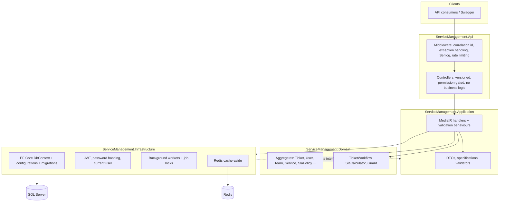
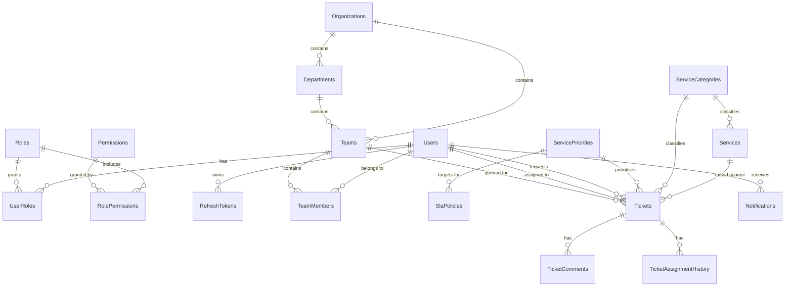
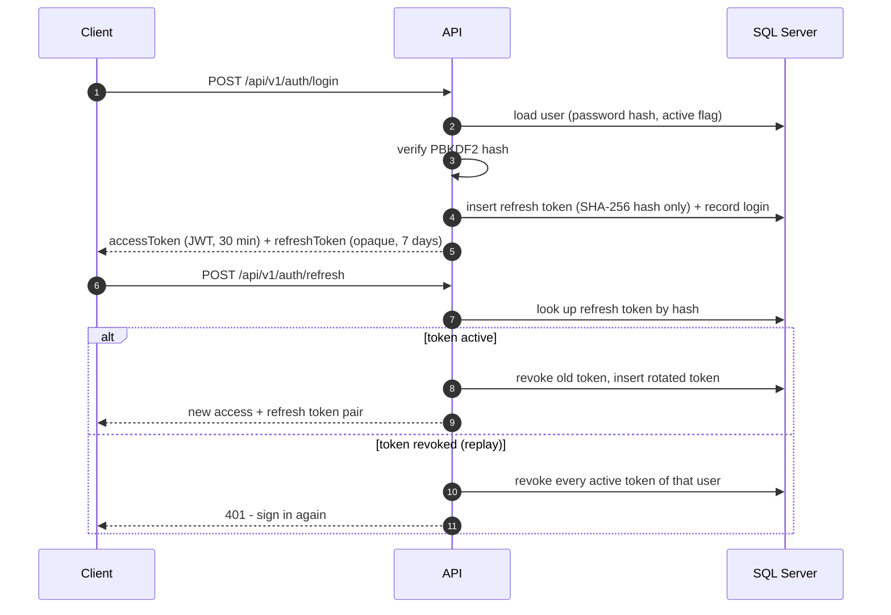
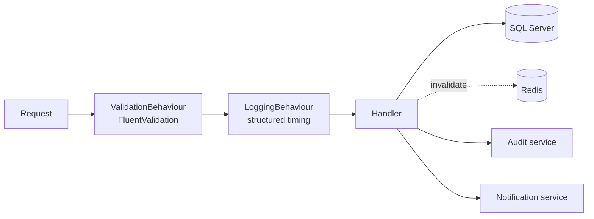
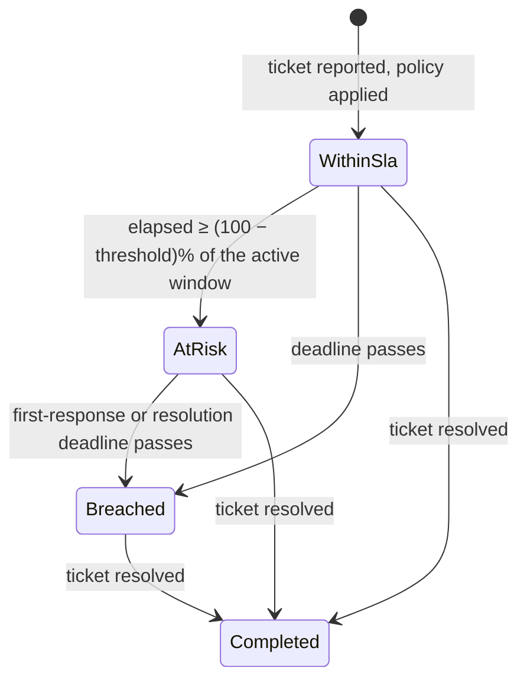
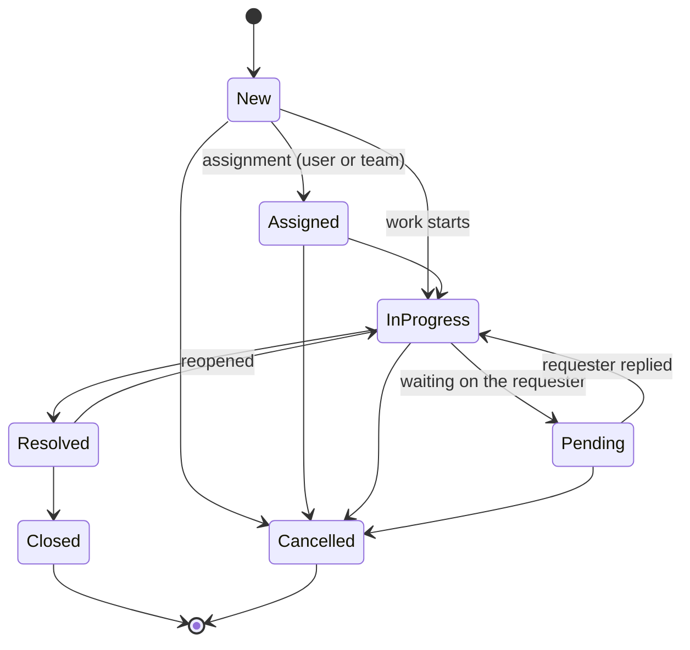

<div align="center">

# Enterprise Service Management Platform

**A production-shaped ASP.NET Core 10 backend for organizational service management: identity, service catalog, ticket lifecycle, SLA tracking, notifications and audit logging.**

[](https://dotnet.microsoft.com/)
[](https://learn.microsoft.com/aspnet/core)
[](https://www.microsoft.com/sql-server)
[](https://redis.io/)
[](https://docs.docker.com/compose/)
[](LICENSE)

</div>

---

## Overview

This repository is a **backend-only** enterprise service management platform. Organizations use it to
raise, classify, route, track and close service tickets; to define service catalogs and SLA targets; and
to keep a complete, tamper-evident trail of who did what.

It is deliberately not a CRUD sample. The interesting parts are the ones that make enterprise backends
hard:

- a **controlled ticket workflow** in which invalid status transitions are impossible, not merely discouraged;
- an **SLA engine** that derives deadlines from database-stored policies and continuously re-evaluates risk;
- **optimistic concurrency** so two agents editing the same ticket cannot silently overwrite each other;
- **idempotent ticket creation** so a retried request never duplicates work;
- **permission-based authorization** with token rotation, reuse detection and revocation;
- **background processing** that is idempotent, duplicate-safe across replicas and observable;
- **audit logging** with redaction, correlation ids and immutable history.

> **Scope note.** No frontend is included: the API, its contract, its persistence model and its tests
> are the deliverable. SQL Server is required; Redis is optional and the API degrades gracefully without it.

---

## Table of contents

- [Architecture](#architecture)
- [Features](#features)
- [Technology stack](#technology-stack)
- [Project structure](#project-structure)
- [Quick start](#quick-start)
- [Database overview](#database-overview)
- [Authentication and authorization](#authentication-and-authorization)
- [CQRS](#cqrs)
- [SLA engine](#sla-engine)
- [Ticket lifecycle](#ticket-lifecycle)
- [Background jobs](#background-jobs)
- [Caching](#caching)
- [Search, filtering and pagination](#search-filtering-and-pagination)
- [Concurrency and idempotency](#concurrency-and-idempotency)
- [Testing](#testing)
- [Docker setup](#docker-setup)
- [API examples](#api-examples)
- [Development seed data](#development-seed-data)
- [Observability](#observability)
- [Screenshots](#screenshots)
- [Documentation](#documentation)
- [Known limitations](#known-limitations)
- [Future improvements](#future-improvements)
- [License](#license)

---

## Architecture

Clean Architecture with a strict, one-directional dependency rule. Nothing in `Domain` knows that
Entity Framework, HTTP or Redis exist.



The **dependency direction** is enforced by project references: `Domain` ← `Application` ←
`Infrastructure` ← `Api`. `Domain` has no package references at all.

> Diagrams are also checked in as Mermaid files under [`docs/diagrams/`](docs/diagrams): system
> architecture, request flow, authentication flow, ticket lifecycle, ERD and background job flow.
>
> Full reasoning: [`docs/ARCHITECTURE.md`](docs/ARCHITECTURE.md).

---

## Features

### Identity and access

- Users, roles and **atomic permissions** (`tickets.assign`, `users.manage`, `audit.read`, …).
- JWT access tokens plus **opaque refresh tokens stored only as SHA-256 hashes**.
- **Refresh token rotation** with **reuse detection**: replaying a revoked token revokes the whole family.
- Password change and account deactivation revoke every outstanding refresh token.
- Activation/deactivation, role assignment and account administration endpoints.

### Service catalog

- Organizations → departments → teams, with team membership and team managers.
- Service categories (hierarchical), services, priorities and **SLA policies** stored in the database.
- Catalog reads are cache-aside cached and invalidated by the commands that change them.

### Tickets

- Ticket numbers allocated from a **SQL Server sequence** (atomic under concurrency, no locking counter table).
- Controlled status workflow with an explicit transition table.
- Assignment to a user and/or a team, with an append-only `TicketAssignmentHistory` trail.
- Public and **internal** comments; internal visibility is enforced in the handler, not just the controller.
- Soft deletion: deleted tickets leave the UI but stay in the table for auditing.
- Optimistic concurrency through a `rowversion` column, surfaced as **HTTP 409**.
- Optional `idempotencyKey` on creation, backed by a filtered unique index.

### Cross-cutting

- Consistent response envelope, centralized exception translation, `ProblemDetails`-aware status codes.
- Correlation ids propagated to responses, logs and audit records.
- Structured Serilog logging (console + rolling file) with request completion logs.
- Health probes: `/health` (full), `/health/live` (process), `/health/ready` (SQL Server + Redis).
- Rate limiting on credential endpoints, strict CORS configuration, secure-by-default secrets handling.

---

## Technology stack

| Area | Choice | Why |
| --- | --- | --- |
| Runtime | .NET 10, C# (latest) | Current LTS-generation platform with nullable reference types. |
| Web | ASP.NET Core Web API, `Asp.Versioning` | URL-segmented `/api/v1` versioning so future versions coexist. |
| Persistence | EF Core 10 + SQL Server | Mature provider; `rowversion`, sequences, filtered indexes, retry-on-failure. |
| Messaging in-process | MediatR | One request → one handler, with pipeline behaviours for validation and logging. |
| Validation | FluentValidation | Composable rules; field errors surface in the API envelope. |
| Mapping | Mapster | Explicit, allocation-light mapping for the few shapes that need it. |
| Query composition | Hand-rolled specification object | `TicketQuerySpecification` keeps filter intent in one testable place without a repository layer. |
| Logging | Serilog | Structured logs with correlation ids and enrichers. |
| Cache | Redis (`IDistributedCache`) | Cache-aside for catalog and dashboard reads; in-memory fallback. |
| Background work | `BackgroundService` workers + SQL Server application locks | Idempotent, duplicate-safe jobs without an extra scheduler dependency. |
| Docs | Swashbuckle / OpenAPI | Swagger UI with XML comments and a Bearer security scheme. |
| Tests | xUnit, FluentAssertions, Testcontainers | Pure unit tests plus container-backed persistence and HTTP tests. |
| Containers | Docker (multi-stage) + Compose | API, SQL Server and Redis in one command. |

Deliberately **not** used: a generic repository (EF Core's `DbContext` already is a unit of work and a
repository), AutoMapper (Mapster covers the need with less ceremony), and a full CQRS bus / event store
(the domain does not need distributed consistency).

---

## Project structure

```
.
├── docker/
│   └── Dockerfile                     # multi-stage build, non-root runtime image
├── docs/
│   ├── diagrams/                      # six Mermaid diagrams (architecture, flows, ERD)
│   ├── API.md                         # endpoint reference and examples
│   ├── ARCHITECTURE.md                # design decisions and trade-offs
│   ├── DATABASE.md                    # schema, indexes, constraints, concurrency
│   ├── DEVELOPMENT.md                 # local setup, migrations, seeding, troubleshooting
│   ├── FINAL_REVIEW.md                # honest engineering self-review
│   ├── PROJECT_ANALYSIS.md            # requirements analysis behind the design
│   └── SECURITY.md                    # threat model and controls
├── src/
│   ├── ServiceManagement.Api/         # controllers, middleware, auth policies, health checks
│   ├── ServiceManagement.Application/ # CQRS handlers, validators, DTOs, abstractions
│   ├── ServiceManagement.Domain/      # aggregates, value objects, workflow, SLA calculation
│   └── ServiceManagement.Infrastructure/ # EF Core, JWT, cache, background jobs, seeding
├── tests/
│   ├── ServiceManagement.ApiTests/         # HTTP lifecycle tests (container-backed)
│   ├── ServiceManagement.IntegrationTests/ # persistence and concurrency (container-backed)
│   └── ServiceManagement.UnitTests/        # domain, validation, mapping and model tests
├── docker-compose.yml                 # api + sqlserver + redis
├── Directory.Build.props              # shared build settings and analyzer policy
└── ServiceManagement.slnx             # solution (XML solution format)
```

---

## Quick start

### Option A — Docker Compose (fastest)

```bash
cp .env.example .env          # adjust MSSQL_SA_PASSWORD and JWT_SIGNING_KEY
docker compose up -d
```

Then open **http://localhost:8080/swagger**. The API applies migrations and seeds development data on
startup; SQL Server and Redis are health-gated before the API starts.

### Option B — Local SDK

```bash
dotnet tool restore
dotnet restore
dotnet build

# SQL Server and Redis (only the database is strictly required)
docker compose up -d sqlserver redis

cd src/ServiceManagement.Api
dotnet user-secrets set "Jwt:SigningKey" "$(openssl rand -base64 48)"
dotnet user-secrets set "ConnectionStrings:Default" "Server=localhost,1433;Database=ServiceManagement;User Id=sa;Pwd=YourStrong!Passw0rd;TrustServerCertificate=True"

dotnet ef database update --project ../ServiceManagement.Infrastructure
dotnet run
```

> **Important:** secrets belong in user secrets or environment variables. `appsettings.json` ships
> placeholders only, and `appsettings.Development.json` contains clearly-labelled throw-away values for
> the local stack.

Step-by-step instructions, migration recipes and troubleshooting: [`docs/DEVELOPMENT.md`](docs/DEVELOPMENT.md).

---

## Database overview

19 tables across five areas, using UUID v7 primary keys (time-ordered, index friendly), `datetimeoffset`
timestamps and explicit foreign keys.



Highlights:

- `Tickets.RowVersion` (`rowversion`) drives optimistic concurrency.
- `IX_Tickets_IdempotencyKey` is unique **and filtered** to `IS NOT NULL`, so many tickets may have no key.
- Indexes exist for the columns ticket search actually filters and sorts on (`Status`, `SlaStatus`,
  `ReportedAt`, `ResolutionDueAt`, assignee/team/requester/priority/service/category), not speculatively.
- `AuditLogs` has **no foreign key to `Users`** on purpose: history must survive user deletion.
- `TicketNumber` comes from the `dbo.TicketNumbers` sequence.

Full schema, index rationale and constraint list: [`docs/DATABASE.md`](docs/DATABASE.md) ·
ERD: [`docs/diagrams/database-erd.md`](docs/diagrams/database-erd.md).

---

## Authentication and authorization



- **Access tokens** are short-lived JWTs carrying `sub`, role claims and one `permission` claim each.
- **Refresh tokens** are 64 random bytes; only their SHA-256 hash is stored, so a database leak is not replayable.
- **Authorization is permission based.** Controllers use `[RequirePermission(Permissions.TicketsAssign)]`,
  which a dynamic policy provider turns into a policy requiring that claim. Role names are never checked.
- Thresholds, rotation and revocation rules: [`docs/SECURITY.md`](docs/SECURITY.md).

---

## CQRS

Commands and queries are separated by intent, not by ceremony:

```csharp
// Command - may change state, returns the updated projection.
public sealed record ChangeTicketStatusCommand(Guid TicketId, TicketStatus Status, string? RowVersion)
    : IRequest<TicketDetailDto>;

// Query - read-only, no tracking, projected in SQL.
public sealed record GetTicketByIdQuery(Guid TicketId) : IRequest<TicketDetailDto>;
```

Both flow through the same MediatR pipeline:



Rules the codebase actually follows:

- **Queries never track.** They use `AsNoTracking()` and project straight into DTOs, so no entity is
  materialised and no change tracker is populated.
- **Handlers own transactions implicitly.** One handler = one `SaveChangesAsync`, so a request commits
  once. Multi-aggregate writes that must be atomic are done inside a single handler.
- **No CQRS where it would be noise.** Simple reads such as listing priorities are queries without a
  command counterpart; purely internal operations do not get a command type invented for them.
- **No generic repository.** Query composition happens with `IQueryable` plus the
  `TicketQuerySpecification` filter object, which keeps filtering declarative and unit-testable.

---

## SLA engine

Deadlines are never hardcoded. They come from `SlaPolicies` rows selected by the ticket's priority (or the
service's default policy when one is configured).



- `SlaCalculator` is a **pure function** with no infrastructure dependency, so the whole matrix is unit tested.
- Deadlines are computed at creation time from `ReportedAt`, and **recalculated when the priority changes**.
- The window in use depends on progress: before the first agent response the first-response deadline
  applies; afterwards the resolution deadline does.
- Missing a first response is a breach **even if the resolution target is still comfortably ahead**.
- `SlaMonitorWorker` re-evaluates open tickets every few minutes and raises `SLANearBreach` / `SLABreached`
  notifications only when the state actually changes.

Example policy (from the development seed):

| Priority | First response | Resolution | At-risk from |
| --- | --- | --- | --- |
| Critical | 30 min | 4 h | 80% of the window elapsed |
| High | 60 min | 8 h | 80% |
| Medium | 4 h | 24 h | 75% |
| Low | 8 h | 48 h | 75% |

---

## Ticket lifecycle



- Transitions live in one place (`TicketWorkflow`) and are enforced inside the aggregate, so a new
  endpoint cannot bypass them.
- Illegal transitions return **409 Conflict** with a message naming both statuses.
- `Closed` and `Cancelled` are terminal: further modification attempts are rejected.
- Moving to `InProgress` stamps the **first response once**; resolving stamps `ResolvedAt`; reopening clears it.

---

## Background jobs

Two `BackgroundService` workers, both disabled with `BackgroundJobs:Enabled=false` (used by tests):

| Worker | Cadence | Responsibility |
| --- | --- | --- |
| `SlaMonitorWorker` | `SlaScanIntervalMinutes` (default 5) | Recompute SLA state for open tickets; raise near-breach/breach notifications (and optionally e-mail). |
| `MaintenanceWorker` | `RefreshTokenCleanupIntervalMinutes` (default 60) | Purge expired/revoked refresh tokens and old read notifications. |

Guarantees:

- **Duplicate-safe across replicas** — each cycle takes a SQL Server application lock
  (`sp_getapplock`); a second instance skips the tick instead of double-processing.
- **Idempotent** — notifications are produced only when a state transition actually happens, so
  re-running a cycle is harmless.
- **Bounded** — at most 500 of the most urgent tickets are examined per tick.
- **Retryable** — a failed cycle is logged and simply retried on the next tick; it never kills the host.
- **Non-blocking** — HTTP requests never wait for job work.

---

## Caching

Cache-aside on top of `IDistributedCache`, with an explicit invalidation strategy:

| Key | Contents | TTL | Invalidated by |
| --- | --- | --- | --- |
| `catalog:services:all` | Service list | `Redis:DefaultTtlMinutes` | Service create/update |
| `catalog:categories:all` | Category list | 10 min | Category create |
| `catalog:priorities:all` | Priorities | 10 min | Priority create |
| `catalog:sla-policies:all` | SLA policies | 10 min | SLA policy create/update |
| `identity:user-permissions:{id}` | Permission set | on write | Role assignment |
| `reports:dashboard` | Dashboard aggregates | 30 s | Short TTL by design |

- **Nothing strongly consistent is cached.** Ticket state is always read from SQL Server.
- If Redis is unreachable every cache operation degrades to a no-op and the request still succeeds:
  `DistributedCacheService` catches failures and logs a warning.
- Set `Redis:Enabled=false` to run a single instance on the in-memory distributed cache.

---

## Search, filtering and pagination

`GET /api/v1/tickets` supports every filter the UI needs, and all of it is pushed into SQL:

```
GET /api/v1/tickets?status=InProgress&priorityId=<guid>&assignedTeamId=<guid>
                   &slaStatus=AtRisk&reportedFrom=2026-01-01&reportedTo=2026-03-01
                   &page=1&pageSize=20&sortBy=reportedAt&sortDescending=true
```

Supported filters: ticket number, title, status, priority, category, service, requester, assignee, team,
SLA state and reported-date range. Supported sort keys: `ticketNumber`, `title`, `status`, `slaStatus`,
`resolutionDueAt`, `resolvedAt`, `reportedAt` (default).

Pagination is always server-side:

```json
{
  "success": true,
  "data": {
    "items": [],
    "page": 1,
    "pageSize": 20,
    "totalCount": 250,
    "totalPages": 13,
    "hasNextPage": true,
    "hasPreviousPage": false
  },
  "message": null,
  "errors": []
}
```

`pageSize` is clamped to 100, and the count is executed as a separate `COUNT(*)` — the API never loads a
table into memory in order to page through it.

---

## Concurrency and idempotency

**Optimistic concurrency.** `Ticket.RowVersion` is a SQL Server `rowversion`. Update/assign/status
endpoints accept the token the client last read; a mismatch is rejected with `409 Conflict` before any
write, and EF Core's own concurrency check catches the narrower race where both requests read the same
version simultaneously.

**Idempotent creation.** `POST /api/v1/tickets` accepts an optional `idempotencyKey`. The same key returns
the ticket created by the first request instead of creating a second one, and a unique filtered index
guarantees the invariant even if two requests race.

---

## Testing

```bash
dotnet test                                  # everything; container tests skip without opt-in
ESMP_RUN_INTEGRATION_TESTS=1 dotnet test     # also runs the SQL Server container tests
```

| Project | What it proves | Runs without infrastructure |
| --- | --- | --- |
| `ServiceManagement.UnitTests` | SLA calculation matrix, workflow transition table, aggregate behaviour, validators, permission logic, Mapster mapping, EF model configuration | ✅ 92 tests |
| `ServiceManagement.IntegrationTests` | Real persistence round-trips, `rowversion` conflicts, sequence allocation, soft-delete visibility, idempotency index, seed idempotency (Testcontainers SQL Server) | opt-in |
| `ServiceManagement.ApiTests` | Host boot, Swagger document, 401 on protected endpoints, JSON 404 fallback, correlation id echo, plus the full HTTP ticket lifecycle | smoke tests ✅, lifecycle opt-in |

The suite is designed to be **runnable from a clean environment**: container-backed tests report as
*skipped*, not failed, when Docker is unavailable — so CI without containers still passes, and CI with
containers gets the stronger signal.

---

## Docker setup

```bash
cp .env.example .env
docker compose up -d
docker compose logs -f api
```

| Service | Image | Port | Notes |
| --- | --- | --- | --- |
| `api` | built from `docker/Dockerfile` | 8080 | Multi-stage build, non-root user, migrations applied on startup |
| `sqlserver` | `mcr.microsoft.com/mssql/server:2022-latest` | 1433 | Health-checked via `sqlcmd`; data in a named volume |
| `redis` | `redis:7-alpine` | 6379 | AOF persistence; health-checked via `redis-cli ping` |

The API waits for both dependencies to report healthy. Tear down with `docker compose down` and drop the
data with `docker compose down -v`.

---

## API examples

Base URL: `http://localhost:8080`, all routes under `/api/v1`.

### Sign in

```bash
curl -X POST http://localhost:8080/api/v1/auth/login \
  -H "Content-Type: application/json" \
  -d '{"email":"admin@servicemanagement.local","password":"Admin#Dev12345!"}'
```

```json
{
  "success": true,
  "data": {
    "accessToken": "eyJhbGciOiJIUzI1NiIs...",
    "accessTokenExpiresAt": "2026-03-01T10:30:00+00:00",
    "refreshToken": "0Yc0mR...",
    "refreshTokenExpiresAt": "2026-03-08T10:00:00+00:00",
    "user": { "id": "...", "fullName": "Ada Admin", "roles": ["Administrator"], "permissions": ["tickets.read", "..."] }
  },
  "message": null,
  "errors": []
}
```

### Raise a ticket

```bash
curl -X POST http://localhost:8080/api/v1/tickets \
  -H "Authorization: Bearer $TOKEN" -H "Content-Type: application/json" \
  -d '{
        "title": "Laptop will not boot",
        "description": "Black screen after the vendor update.",
        "serviceId": "<service-guid>",
        "categoryId": "<category-guid>",
        "idempotencyKey": "order-2026-0042"
      }'
```

### Move a ticket through the workflow

```bash
curl -X POST http://localhost:8080/api/v1/tickets/$TICKET_ID/status \
  -H "Authorization: Bearer $TOKEN" -H "Content-Type: application/json" \
  -d '{"status":"InProgress","rowVersion":"AAAAAAAAB9E="}'
```

Illegal transitions answer with the documented conflict:

```json
{
  "success": false,
  "data": null,
  "message": "Ticket status cannot change from 'New' to 'Resolved'.",
  "errors": [],
  "correlationId": "0195e2..."
}
```

### Validation failure

```json
{
  "success": false,
  "data": null,
  "message": "Validation failed",
  "errors": [{ "field": "title", "message": "Title is required." }],
  "correlationId": "0195e2..."
}
```

Every endpoint, with request/response models and status codes: [`docs/API.md`](docs/API.md) and the live
Swagger UI at `/swagger`.

---

## Development seed data

Applied automatically in the `Development` environment when the database is empty.

| Account | Password | Role |
| --- | --- | --- |
| `admin@servicemanagement.local` | `Admin#Dev12345!` | Administrator |
| `manager@servicemanagement.local` | `Manager#Dev12345!` | Manager |
| `agent@servicemanagement.local` | `Agent#Dev12345!` | Agent |
| `requester@servicemanagement.local` | `Requester#Dev12345!` | Requester |

Also seeded: one organization with a department and a “Service Desk” team, three service categories,
four priorities with matching SLA policies, three services, and four tickets spread across the workflow
and SLA clock.

> These are **development credentials**, hardcoded for a throwaway local database and never used to
> configure a deployment. Real accounts are created through `POST /api/v1/users`.

---

## Observability

- **Correlation ids** — supplied via `X-Correlation-Id` or generated; echoed in the response, pushed into
  the Serilog context and stored on audit records, so one id ties an HTTP response to its logs and history.
- **Structured logs** — request completion logs (method, path, status, duration), handler timing from the
  MediatR logging behaviour, and warnings/errors with the exception attached.
- **Health probes** — `/health/live` (process only) and `/health/ready` (SQL Server + Redis) return JSON
  with per-check status and duration, suitable for Kubernetes probes or a load balancer.
- **Audit trail** — login, token refresh, user and role changes, ticket create/update/assign/status/comment,
  SLA policy changes and deletions, each with old/new JSON snapshots and sensitive fields redacted.

---

## Screenshots

This is a backend-only repository, so there are no UI screenshots. The equivalents are below — replace
them with your own captures if you fork this project:

| Placeholder | What to capture |
| --- | --- |
| `docs/screenshots/swagger-overview.png` | Swagger UI listing the versioned endpoint groups |
| `docs/screenshots/swagger-auth.png` | The Bearer security scheme and an authenticated "Try it out" |
| `docs/screenshots/health-ready.png` | `/health/ready` reporting SQL Server and Redis as healthy |
| `docs/screenshots/dashboard-response.png` | The dashboard aggregate returned as JSON |

---

## Documentation

| Document | Contents |
| --- | --- |
| [`docs/PROJECT_ANALYSIS.md`](docs/PROJECT_ANALYSIS.md) | Requirements analysis: entities, rules, boundaries, risks, testing strategy |
| [`docs/ARCHITECTURE.md`](docs/ARCHITECTURE.md) | Layering, dependency rules, CQRS, caching, background processing, trade-offs |
| [`docs/DATABASE.md`](docs/DATABASE.md) | Tables, relationships, indexes, constraints, concurrency strategy |
| [`docs/API.md`](docs/API.md) | Endpoint reference, envelope, error codes, pagination contracts |
| [`docs/SECURITY.md`](docs/SECURITY.md) | Threat model, token lifecycle, password policy, logging and secret handling |
| [`docs/DEVELOPMENT.md`](docs/DEVELOPMENT.md) | Local setup, migrations, seed data, troubleshooting |
| [`docs/FINAL_REVIEW.md`](docs/FINAL_REVIEW.md) | Post-implementation engineering review, including what is weak |
| [`docs/diagrams/`](docs/diagrams) | Six Mermaid diagrams rendered natively by GitHub |

---

## Known limitations

Stated plainly, because a portfolio project that hides its edges is not credible:

1. **No frontend.** Deliberate: the backend is the deliverable.
2. **E-mail delivery is a logging implementation.** `IEmailSender` and its call sites are real; the
   transport is a mock. Wiring SMTP/SendGrid is a configuration exercise, not an architecture change.
3. **Attachments are not implemented.** The domain anticipates metadata only; there is no blob storage.
4. **The specification pattern is hand-rolled.** `TicketQuerySpecification` implements the same idea
   (filter intent as an object) without the Ardalis dependency. Swapping in Ardalis is mechanical.
5. **Background workers do not use a durable scheduler.** `BackgroundService` + SQL Server application
   locks is genuinely duplicate-safe, but there is no job history UI or dead-letter queue.
6. **Integration and API lifecycle tests need Docker.** They skip cleanly when it is absent, which means
   a container-less CI run does not exercise real SQL Server behaviour.
7. **Rate limiting is in-process.** It is per-instance; a multi-replica deployment should move the
   counters to Redis or the ingress.
8. **Notifications are poll-based.** Clients poll `GET /api/v1/notifications`; there is no SignalR/WebSocket channel.
9. **No refresh-token binding to device/user agent.** Rotation and reuse detection are implemented, but
   tokens are not bound to a specific client fingerprint.

---

## Future improvements

Ordered by value rather than effort:

1. **Observability depth** — OpenTelemetry traces and metrics, plus Seq or Loki as a log sink.
2. **Outbox for notifications** — transactional outbox so notification delivery survives process death.
3. **Attachment storage** — presigned uploads to blob storage with virus scanning and metadata rows.
4. **Reporting expansion** — per-team SLA compliance trends, first-response distributions, CSV export.
5. **Real e-mail provider** — swap `LoggingEmailSender` for an SMTP/API implementation plus templating.
6. **Durable job orchestration** — Hangfire or Quartz with a job history table and dead-letter handling.
7. **Distributed rate limiting** — Redis-backed counters for multi-replica deployments.
8. **Real-time updates** — SignalR hub for ticket and notification push.
9. **Contract testing** — publish the OpenAPI document and validate clients against it in CI.
10. **Load profile** — k6 or NBomber scenarios for the ticket search endpoint, with index tuning from
    real execution plans.

---

## License

Released under the [MIT License](LICENSE).
