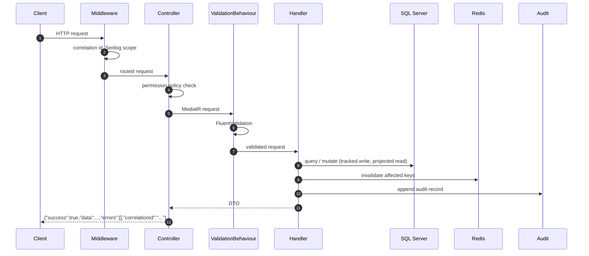

# Architecture

## 1. Style and layering

Clean Architecture as a modular monolith: one deployable API, four internal layers, and a dependency rule
that only points inwards.

```
Domain  ←  Application  ←  Infrastructure  ←  Api
```

| Layer | Contains | May reference | Must not reference |
| --- | --- | --- | --- |
| `ServiceManagement.Domain` | Aggregates, enums, domain exceptions, `TicketWorkflow`, `SlaCalculator`, `Guard` | nothing | EF Core, ASP.NET Core, any package |
| `ServiceManagement.Application` | MediatR handlers, validators, DTOs, cache/notification/security abstractions, options classes | Domain, EF Core abstractions | ASP.NET Core, Redis, SQL Server |
| `ServiceManagement.Infrastructure` | `ApplicationDbContext`, entity configurations, migrations, seeding, JWT, hashing, cache, background workers | Application, Domain | Api |
| `ServiceManagement.Api` | Controllers, middleware, authorization policies, health checks, Swagger, composition root | all | — |

Consequences that are actually visible in the code:

- `Domain` has an empty `<ItemGroup>` of packages — literally no dependencies.
- The clock is an interface (`IDateTimeProvider`), so SLA and token expiry logic is deterministic in tests.
- The application layer never sees `HttpContext`; it sees `ICurrentUserService`.
- Persistence is behind `IApplicationDbContext`, which is still EF-shaped on purpose — hiding EF behind a
  repository would have forced leaky abstractions without buying anything.

## 2. Why a modular monolith

| Alternative | Why it was rejected |
| --- | --- |
| Microservices | A single team, one database, one deployment. The operational cost would exceed the benefit, and ticket/SLA/identity data is inherently co-transactional. |
| Layered CRUD with services | Cannot express invariants such as the status workflow or SLA derivation without scattering them across handlers. |
| Vertical slices only | Attractive, but the domain rules here (SLA maths, workflow, permissions) are genuinely shared, and duplicating them per slice invites drift. |
| Generic repository + unit of work | `DbContext` already is a unit of work and exposes `DbSet` as a repository. An extra abstraction would only obscure query composition. |

The layering is modular in the sense that matters: **Identity**, **Organizations**, **Catalog**,
**Tickets**, **Notifications**, **Audit** and **Reporting** are separate folders with separate contracts,
and cross-module interaction goes through interfaces, not through each other's internals.

## 3. Request flow



Every failure path funnels through `GlobalExceptionHandler`, which maps exception type → status code +
message + field errors, logs with the correlation id, and never leaks internals.

## 4. CQRS strategy

CQRS here means *separated intent*, not separate databases:

| Aspect | Commands | Queries |
| --- | --- | --- |
| Return | The updated projection (so clients do not need a follow-up GET) | DTO / `PagedResult<T>` |
| Tracking | Tracked (mutations need it) | `AsNoTracking()` |
| Shape | Validation-first, side effects (audit, notifications, cache invalidation) | Projection straight into the DTO, no entity materialisation |
| Examples | `CreateTicketCommand`, `AssignTicketCommand`, `ChangeTicketStatusCommand`, `AddTicketCommentCommand`, `CreateUserCommand` | `GetTicketByIdQuery`, `SearchTicketsQuery`, `GetTicketHistoryQuery`, `GetDashboardQuery`, `GetNotificationsQuery` |

Deliberately absent: command/query buses over the network, event sourcing, and a separate read model.
They would add operational surface without solving a problem this system has.

## 5. Persistence design decisions

| Decision | Rationale |
| --- | --- |
| `IEntityTypeConfiguration<T>` per entity | `OnModelCreating` stays a three-line method; each mapping is reviewable next to the entity it maps. |
| UUID v7 keys | Time-ordered, so clustered indexes stay fragmented far less than with UUID v4, without giving up client-generatable ids. |
| `rowversion` on `Ticket` only | Tickets are the only aggregate with genuine concurrent editors; adding concurrency tokens everywhere would be cargo cult. |
| Empty-string-free soft delete | `IsDeleted` + `DeletedAt` on the aggregate, a global query filter for reads, and `IgnoreQueryFilters()` when history is required. |
| Sequence for ticket numbers | Atomic without a locking counter table, and gap-tolerant if a transaction rolls back. |
| Filtered unique index on `IdempotencyKey` | Many tickets legitimately have no key; SQL Server filtered indexes express exactly that. |
| No FK from `AuditLogs` to `Users` | Audit history must outlive user deletion. |
| Matching query filters on children | Ticket comments and assignment history inherit ticket visibility, so a soft-deleted ticket's children never leak. |

## 6. Authorization design

```
JWT claim "permission" (one per permission)
        │
        ▼
[RequirePermission(Permissions.TicketsAssign)]
        │  policy name "permission:tickets.assign"
        ▼
PermissionPolicyProvider  ──builds on demand──▶  AuthorizationPolicy
        │
        ▼
PermissionAuthorizationHandler ──▶ PermissionEvaluator (case-insensitive match)
```

Creating a new permission therefore requires **no registration**: add the constant, grant it in the seed,
decorate the endpoint. Role names never appear in authorization decisions — they are only a convenience
for grouping permissions.

## 7. Caching strategy

Cache-aside with an explicit invalidation contract per key (see the README table). The rule applied
throughout: **cache only what can tolerate a stale read**. Catalog data and dashboard aggregates qualify;
ticket state, permissions-at-decision-time and audit data do not. Every cache operation is wrapped so a
Redis outage degrades performance, never correctness.

## 8. Background processing

```
SlaMonitorWorker ─┐
                  ├─▶ DatabaseJobLock (sp_getapplock, session owner)
MaintenanceWorker ┘        │
                           ├── acquired → run cycle → release
                           └── not acquired → log + skip this tick
```

Why not Hangfire/Quartz: the platform needs two periodic, idempotent, replica-safe cycles — not
scheduling, dashboards or retry policies for arbitrary jobs. `BackgroundService` plus a database
application lock delivers exactly the required guarantee with no extra infrastructure, and the workers
remain ordinary DI-scoped code that unit tests can reason about. Swapping in a durable scheduler later is
a contained change because the work itself lives in private `RunAsync` methods.

## 9. Error handling and API contract

One envelope for success and failure, one exception map, one place to redact:

| Exception | HTTP | Message source |
| --- | --- | --- |
| `ValidationException` (FluentValidation) | 400 | Field-level errors |
| `DomainRuleViolationException` | 400 | Domain message |
| `InvalidStatusTransitionException` | 409 | Names both statuses |
| `ConflictException` | 409 | Caller-supplied |
| `DbUpdateConcurrencyException` | 409 | Fixed message, no internals |
| `NotFoundException` | 404 | Entity and identifier |
| `ForbiddenException` | 403 | Caller-supplied |
| `UnauthorizedException` / challenge | 401 | Fixed message |
| anything else | 500 | Generic message, internals logged only |

`ProblemDetails` compatibility: the project standardises on the envelope required by the API contract
(§14) rather than emitting `application/problem+json`, so clients parse one shape for every response.
Status codes remain the ones `ProblemDetails` would use, and the exception handler is registered through
`IExceptionHandler`, which is the same extension point.

## 10. Trade-offs accepted

| Trade-off | Accepted cost | Why it is still the right call |
| --- | --- | --- |
| No outbox | A crash between `SaveChanges` and a notification write can lose a notification | Transactional outbox is on the roadmap; database notifications are best-effort by nature |
| `IApplicationDbContext` exposes EF types | Application layer is coupled to EF Core abstractions | Avoids a repository layer that would leak `IQueryable` anyway |
| Hand-rolled specification | Less feature-rich than Ardalis.Specification | One filter object with zero third-party coupling, fully testable |
| Dashboard cached for 30 s | Brief staleness | Dashboard is an aggregate view, not an operational control |
| In-process rate limiting | Per-replica limits | Correct for a single deployment; documented for multi-replica |
