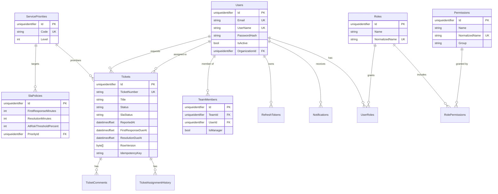

# Database design

SQL Server 2022 (or newer). The schema is created and evolved exclusively through EF Core migrations —
`EnsureCreated` is never used, so the database always has a versioned, replayable history.

## 1. Conventions

| Convention | Value | Reason |
| --- | --- | --- |
| Primary keys | `uniqueidentifier`, UUID v7 | Time-ordered, so clustered index inserts stay sequential; safe to generate client-side |
| Timestamps | `datetimeoffset` | Unambiguous across time zones; SLA maths is offset-aware |
| Soft delete | `bit IsDeleted` + `datetimeoffset? DeletedAt` | Business data is retained for auditability |
| Concurrency | `rowversion` on `Tickets` | SQL Server native, no application bookkeeping |
| Deletes | Smallest possible blast radius (`Restrict` by default) | Prevents accidental cascade of historical records |
| Naming | EF conventions, PascalCase identifiers | Matches the C# model; no rename mapping to maintain |

## 2. Tables

### Identity

| Table | Purpose | Notable columns and constraints |
| --- | --- | --- |
| `Users` | Application users | `Email` unique, `UserName` unique, `PasswordHash` (PBKDF2), `SecurityStamp`, `IsActive`, `OrganizationId` indexed |
| `Roles` | Permission groups | `NormalizedName` unique, `IsSystemRole` |
| `Permissions` | Atomic capabilities | `NormalizedName` unique, `Group` indexed, `Name` like `tickets.assign` |
| `UserRoles` | User ↔ role | Unique `(UserId, RoleId)`; cascade on user/role delete |
| `RolePermissions` | Role ↔ permission | Unique `(RoleId, PermissionId)`; cascade on role delete |
| `RefreshTokens` | Refresh token registry | `TokenHash` unique (SHA-256 hex), `ExpiresAt` indexed, `RevokedAt`, `ReplacedByTokenHash`, `ReasonRevoked` |

Only the **hash** of a refresh token is stored. `ReplacedByTokenHash` records rotation, and a token that is
presented after revocation triggers family-wide revocation.

### Organizations

| Table | Purpose | Notable columns and constraints |
| --- | --- | --- |
| `Organizations` | Tenant boundary | `Code` unique |
| `Departments` | Functional area | Unique `(OrganizationId, Code)` |
| `Teams` | Assignment queue | Unique `(DepartmentId, Code)`; `ManagerId` → `Users` with `SET NULL` |
| `TeamMembers` | Team membership | Unique `(TeamId, UserId)`; `IsManager`, `JoinedAt` |

### Service catalog

| Table | Purpose | Notable columns and constraints |
| --- | --- | --- |
| `ServiceCategories` | Hierarchical classification | `Code` unique; self-referencing `ParentId` (`Restrict`, so a parent cannot be deleted while children exist) |
| `ServicePriorities` | Priority scale | `Code` unique, `Level` indexed (1 = most urgent) |
| `SlaPolicies` | Response/resolution targets | `PriorityId` indexed, `IsActive` indexed, `FirstResponseMinutes`, `ResolutionMinutes`, `AtRiskThresholdPercent` |
| `Services` | Catalog entries | `Code` unique, `CategoryId` indexed, `DefaultPriorityId`, `DefaultSlaPolicyId` |

### Tickets

| Table | Purpose | Notable columns and constraints |
| --- | --- | --- |
| `Tickets` | The aggregate | `TicketNumber` unique, `RowVersion` rowversion, `Status`, `SlaStatus`, `ReportedAt`, `FirstResponseDueAt`, `ResolutionDueAt`, `ResolvedAt`, `ClosedAt`, `IdempotencyKey` |
| `TicketComments` | Conversation | `(TicketId, CreatedAt)` and `(TicketId, IsInternal)` indexed, `AuthorId` → `Users` (`Restrict`) |
| `TicketAssignmentHistory` | Append-only trail | `(TicketId, ChangedAt)` indexed, `ChangedBy` indexed |

`Tickets` index inventory (chosen from real filter/sort patterns, not speculatively):

| Index | Serves |
| --- | --- |
| `IX_Tickets_TicketNumber` (unique) | Lookup by ticket number |
| `IX_Tickets_IdempotencyKey` (unique, filtered `IS NOT NULL`) | Idempotent creation |
| `IX_Tickets_Status` | Status filter and open-ticket scans |
| `IX_Tickets_SlaStatus` | SLA dashboards and the monitor's candidate query |
| `IX_Tickets_ReportedAt` | Default sort, date-range filters |
| `IX_Tickets_ResolutionDueAt` | SLA monitor ordering, "due soon" screens |
| `IX_Tickets_PriorityId`, `IX_Tickets_ServiceId`, `IX_Tickets_CategoryId` | Catalog filters |
| `IX_Tickets_RequesterId` | "My tickets" |
| `IX_Tickets_AssignedToId` | Agent queue |
| `IX_Tickets_AssignedTeamId` | Team queue |

### Cross-cutting

| Table | Purpose | Notable columns and constraints |
| --- | --- | --- |
| `Notifications` | Per-user inbox | `(UserId, IsRead)` indexed, `CreatedAt` indexed, `UserId` cascade |
| `AuditLogs` | Immutable history | `OccurredAt`, `(EntityName, EntityId)`, `Action`, `UserId` indexed; check constraint `Action <> ''`; **no FK to `Users`** |

## 3. Relationship summary



## 4. Concurrency strategy

**Optimistic, token-based.** Tickets carry a `rowversion`. An `UPDATE` includes
`WHERE Id = @id AND RowVersion = @original`, so the database itself rejects a stale write. Two layers
protect the client:

1. `TicketConcurrency.EnsureUnchanged` compares the token the client sent with the token just read, and
   raises `ConflictException` (409) before attempting any write.
2. If both requests read the same version simultaneously, EF Core's concurrency check throws
   `DbUpdateConcurrencyException`, which the exception handler also maps to 409.

Callers therefore receive either a successful write or an explicit "somebody else changed this — reload"
signal. They never receive silent lost updates.

**Ticket numbering** uses the `dbo.TicketNumbers` sequence, allocated with
`SELECT NEXT VALUE FOR dbo.TicketNumbers`. Values may have gaps after a rollback, which is standard
sequence behaviour and preferable to a locking counter table.

## 5. Index and constraint rationale

- Every index above maps to a filter or sort used by `TicketQuerySpecification` or a background worker
  query; there are no speculative indexes.
- Uniqueness is used as an invariant, not decoration: emails, usernames, organisation/department/team
  codes, ticket numbers and refresh token hashes cannot be duplicated even under concurrency.
- `ON DELETE RESTRICT` is the default for catalog references so removing a category cannot silently delete
  ticket history; `SET NULL` is used where a reference is genuinely optional (ticket assignee, team manager).
- The `AuditLogs` check constraint rejects empty actions at the database level, not just in C#.
- Foreign keys are returned as part of the EF model, so they are visible in `dotnet ef migrations script`.

## 6. Migrations

```bash
# add a migration after changing the model
dotnet ef migrations add <DescriptiveName> \
  --project src/ServiceManagement.Infrastructure \
  --startup-project src/ServiceManagement.Api \
  --output-dir Persistence/Migrations

# apply
dotnet ef database update --project src/ServiceManagement.Infrastructure --startup-project src/ServiceManagement.Api
```

The initial migration (`InitialCreate`) creates all 19 tables, the `TicketNumbers` sequence and every
index and constraint described above. The API applies pending migrations at startup when
`Database:ApplyMigrationsOnStartup` is `true` (the default), and only seeds data in `Development`.
