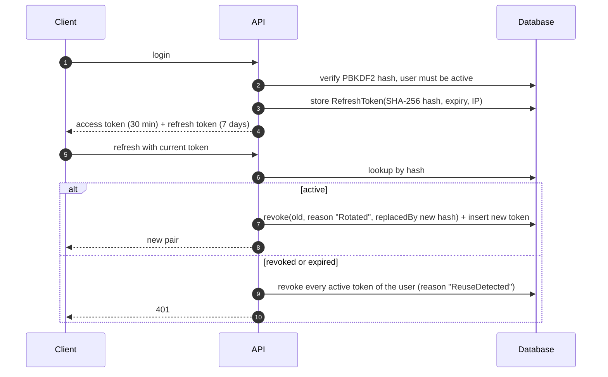

# Security

## 1. Principles

1. **Credentials never reach source control, logs, or the audit trail.**
2. **Authorization is about capabilities (permissions), not role names.**
3. **Fail closed** — an unknown origin is rejected, a missing configuration is a startup error, an
   unauthenticated request is 401 rather than silently proceeding.
4. **Security failures are observable** — login failures, token reuse and permission denials are audited
   and logged with correlation ids.

## 2. Threat model (abbreviated STRIDE)

| Threat | Vector | Control |
| --- | --- | --- |
| Spoofing | Stolen access token | 30-minute lifetime, HTTPS-only metadata (`RequireHttpsMetadata = true`), security stamp rotation on password change/deactivation |
| Spoofing | Stolen refresh token | 64 random bytes, stored **hashed** (SHA-256), rotated on every use, reuse detection revokes the family |
| Tampering | Arbitrary status/field writes | Domain-enforced workflow, `rowversion` optimistic concurrency, DTO-only projections |
| Repudiation | "I never did that" | `AuditLogs` with actor, action, entity, IP, correlation id and old/new JSON snapshots; login failures audited too |
| Information disclosure | Verbose error responses | `IExceptionHandler` maps exceptions to fixed messages; internals logged server-side only |
| Information disclosure | Internal comments leaking | `tickets.comment.internal` permission enforced in the handler; history filter and notifications both exclude them |
| Information disclosure | Secrets in logs | Passwords/tokens/hashes/keys are never logged; audit JSON passes a redactor before persistence |
| Denial of service | Credential brute force | Fixed-window rate limit (10/min/IP) on `login` and `refresh` |
| Denial of service | Unbounded queries | Pagination clamped to 100, indexed filters, server-side paging everywhere |
| Elevation of privilege | Role-name guessing | Permissions are issued as claims from the database; a client cannot claim a permission the token was not issued with |
| Injection | Malicious input | EF Core parameterised queries; FluentValidation with explicit length/range rules; no raw SQL with user input |
| Misconfiguration | Committed secrets | `appsettings.json` holds placeholders only; user secrets / environment variables documented; `.env` git-ignored |

## 3. Token lifecycle

| Property | Implementation |
| --- | --- |
| Access token | HMAC-SHA256 JWT, ≥32-char key (validated lazily with a clear error), issuer/audience validated, 30-second clock skew |
| Refresh token | 64 cryptographically random bytes, base64-encoded, single use |
| Storage | `TokenHash = SHA-256(token)`, unique index for O(1) lookup |
| Rotation | Old token is revoked with `ReplacedByTokenHash` pointing at its successor |
| Reuse detection | Presenting a revoked token revokes all active tokens for that user and is audited |
| Logout | Revokes the presented token; idempotent |
| Password change | Rotates the security stamp (invalidates access tokens) and revokes all refresh tokens |
| Deactivation | Same as password change: stamp rotation plus refresh token revocation |

## 4. Password handling

- Hashing uses ASP.NET Core Identity's PBKDF2 (HMAC-SHA256, per-password salt, 100k+ iterations) through
  `IdentityPasswordHasher` — no custom crypto is written.
- Policy enforced by FluentValidation: 12+ characters, upper case, lower case, digit, symbol, and the new
  password must differ from the current one.
- `LoginCommandHandler` returns the same generic message for "unknown user" and "wrong password", so the
  endpoint cannot enumerate accounts. Failed logins are audited as `LoginFailed`.

## 5. Authorization

- Permission → policy mapping is dynamic (`PermissionPolicyProvider`), so adding a permission requires no
  registration code.
- Controllers express intent as `[RequirePermission(Permissions.TicketsAssign)]`.
- Handlers re-check what matters semantically: internal comments (`TicketAccessPolicy`) are enforced in the
  application layer as well, so a new endpoint cannot expose them by accident.
- 401 responses (challenge/forbidden) are emitted in the standard envelope by `JwtBearerEvents`.

## 6. Input validation and injection defence

- Every command has a FluentValidation validator; `ValidationBehaviour` runs them before the handler.
- All data access goes through EF Core (parameterised). The only raw SQL is the ticket number sequence
  (`SELECT NEXT VALUE FOR dbo.TicketNumbers`) which contains no user input.
- String lengths are bounded at both the validator and the column (`nvarchar(n)`), so oversized payloads
  fail early instead of truncating silently.
- `AutomaticallyValidateAntiForgeryTokens`-style magic is not needed: the API is token-authenticated.

## 7. Secrets and configuration

| Secret | Where it lives | Where it must not live |
| --- | --- | --- |
| `Jwt:SigningKey` | User secrets (dev) / environment or secret store (prod) | `appsettings.json`, source control |
| `ConnectionStrings:Default` | User secrets (dev) / `.env` + Compose (local stack) | Source control |
| Development seed passwords | `DatabaseSeeder` constants, documented in the README | Any deployed environment |

- `appsettings.json` contains placeholders and an explanatory comment; the API refuses to start with an
  unconfigured connection string and fails with a clear message.
- `JwtTokenService` throws a descriptive exception if the signing key is missing or shorter than 32
  characters — a misconfiguration fails loudly at the first token request, not silently forever.
- `Jwt:RequireHttpsMetadata` stays `true`, so bearer tokens are never exchanged over plain HTTP in
  production configuration.

## 8. Logging and audit redaction

- Serilog writes structured events with the correlation id; request/response bodies are never logged.
- `AuditService.Redact` rewrites any JSON property whose name contains `password`, `secret`, `token`,
  `hash`, `signingKey` or `connectionString` before it is persisted, so even a careless caller cannot leak
  a credential into `AuditLogs`.
- Background workers log outcomes (state transitions, purge counts) and errors — never payloads.

## 9. Transport, CORS and headers

- `RequireHttpsMetadata = true` for the metadata endpoint; deployment is expected to terminate TLS at the
  ingress and serve HSTS there.
- CORS is deny-by-default: with no `Cors:AllowedOrigins` configured, no browser origin is accepted.
  Development adds only localhost origins.
- Unmatched routes return the standard envelope with 404 via a `MapFallback` endpoint instead of an empty
  IIS/Kestrel body.
- Rate limiting returns 429 and is applied only to the sensitive endpoints, so it cannot be abused to
  starve normal traffic.

## 10. Known residual risks (tracked in the final review)

- Rate limiting is per instance; multi-replica deployments should move counters to Redis or the ingress.
- Notifications are poll-based; there is no real-time push channel.
- E-mail delivery is a logging mock until a provider is wired into `IEmailSender`.
- No device binding or IP pinning on refresh tokens (rotation + reuse detection only).
- No CSP/HSTS headers are emitted by the API itself; that belongs to the hosting layer today.
