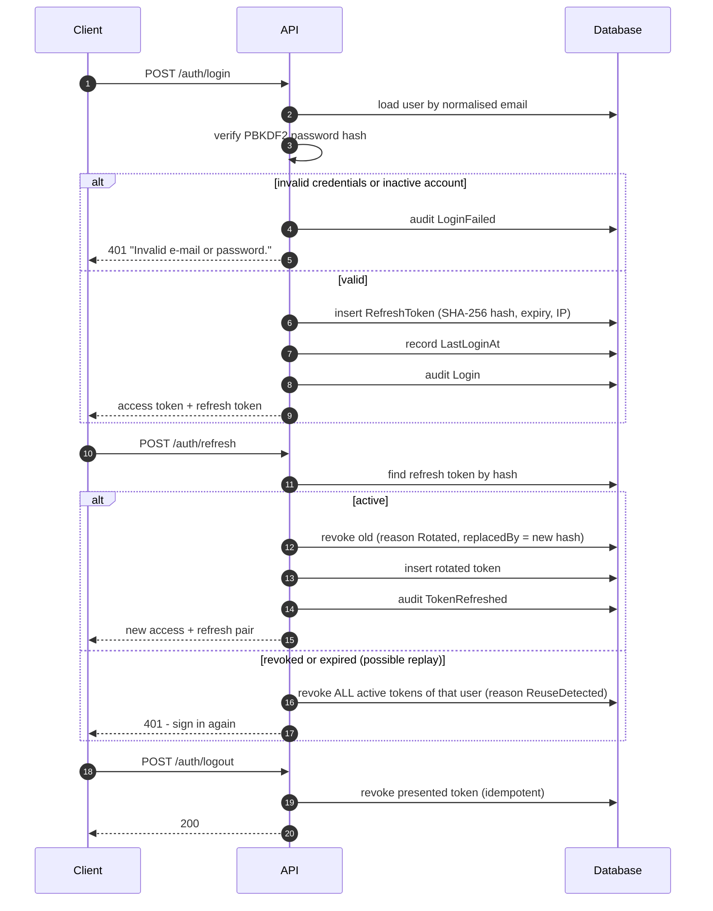
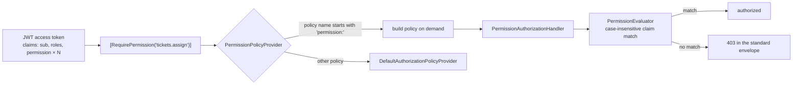

# Authentication flow

## Login, rotation and reuse detection

## Permission-based authorization

## Token properties

| Property | Value |
| --- | --- |
| Access token | HMAC-SHA256 JWT, issuer/audience validated, 30-minute lifetime, 30-second clock skew |
| Refresh token | 64 random bytes, single use, 7-day lifetime |
| Stored form | `SHA-256(token)` hex — the raw token is never persisted |
| Rotation | Every refresh invalidates the presented token and links it to its successor |
| Reuse response | The whole active token family of that user is revoked |
| Password change / deactivation | Security stamp rotated (invalidates access tokens) + all refresh tokens revoked |
