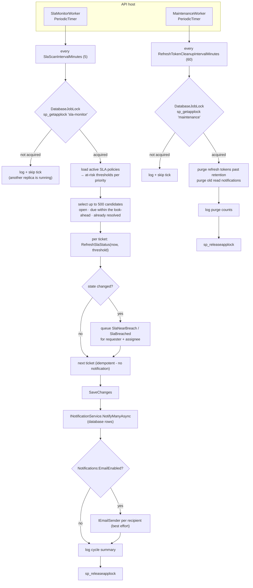
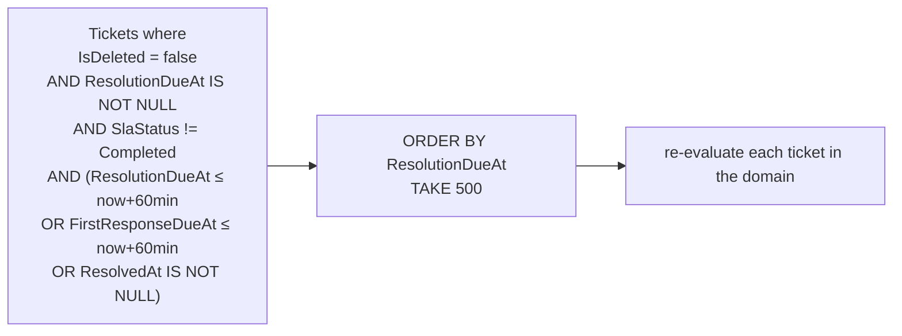

# Background job flow

## Guarantees

| Property | How it is achieved |
| --- | --- |
| **Duplicate-safe across replicas** | `sp_getapplock` with a session-scoped exclusive lock; a second instance skips the tick instead of double-processing |
| **Idempotent** | Notifications are queued only when an SLA state actually changes; purges are naturally idempotent |
| **Bounded** | At most 500 candidates per tick, ordered by urgency; maintenance deletes in set-based statements |
| **Retryable** | A failed cycle is logged and retried on the next tick — it never terminates the host |
| **Observable** | Each cycle logs tickets evaluated and transitions recorded; the API exposes `/health/ready` for dependency state |
| **Non-blocking** | No HTTP request waits for job work; workers run in their own DI scopes with their own `DbContext` |

## Candidate selection

