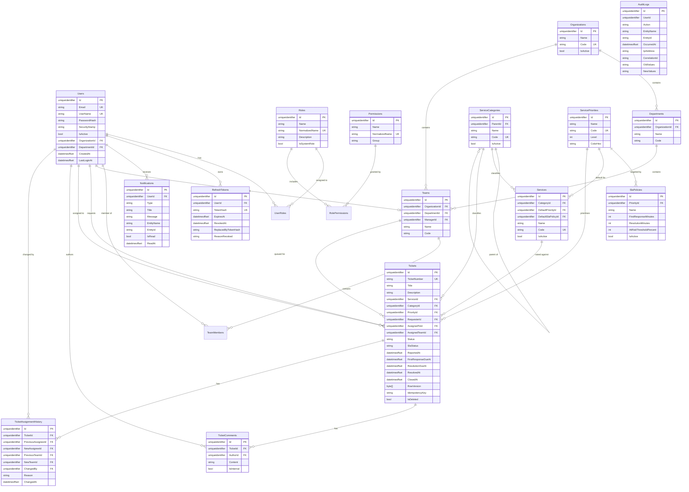

# Database ERD

## Index highlights

| Table | Index | Purpose |
| --- | --- | --- |
| `Tickets` | `IX_Tickets_TicketNumber` (unique) | Number lookup |
| `Tickets` | `IX_Tickets_IdempotencyKey` (unique, filtered `IS NOT NULL`) | Idempotent creation |
| `Tickets` | `Status`, `SlaStatus`, `ReportedAt`, `ResolutionDueAt` | Queue views, SLA monitor, default sort |
| `Tickets` | `RequesterId`, `AssignedToId`, `AssignedTeamId` | "My tickets", agent queue, team queue |
| `TicketComments` | `(TicketId, CreatedAt)`, `(TicketId, IsInternal)` | Timeline read, internal visibility filter |
| `TicketAssignmentHistory` | `(TicketId, ChangedAt)` | History read |
| `RefreshTokens` | `TokenHash` (unique), `ExpiresAt` | Refresh lookup, cleanup sweep |
| `Notifications` | `(UserId, IsRead)`, `CreatedAt` | Inbox read, retention purge |
| `AuditLogs` | `OccurredAt`, `(EntityName, EntityId)`, `Action`, `UserId` | Audit search (no FK to `Users` by design) |
