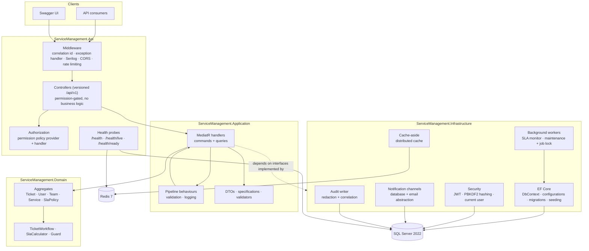
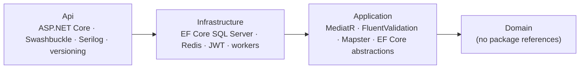

# System architecture

## Dependency rule

Arrows point **inwards only**. `Domain` cannot see Entity Framework, HTTP or Redis; `Application` cannot
see ASP.NET Core. Cross-boundary work happens through interfaces declared in `Application` and implemented
in `Infrastructure`.
