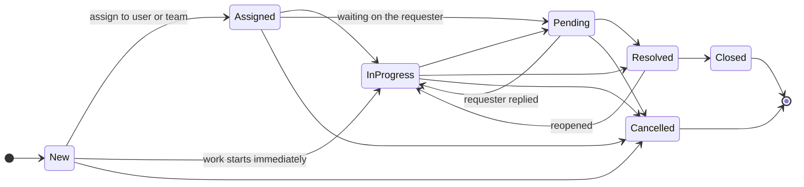
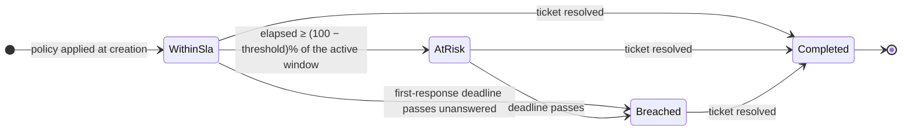
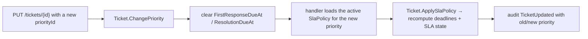

# Ticket lifecycle

## Status machine

| Status | Terminal | Effect on timestamps |
| --- | --- | --- |
| `New` | no | — |
| `Assigned` | no | assignment history entry appended |
| `InProgress` | no | first response stamped **once** |
| `Pending` | no | — |
| `Resolved` | no | `ResolvedAt` set; clears on reopen |
| `Closed` | **yes** | `ClosedAt` set; entity becomes read-only |
| `Cancelled` | **yes** | entity becomes read-only |

Every illegal transition raises `InvalidStatusTransitionException`, which the API returns as **409** naming
both statuses. Repeating the current status is rejected as a domain rule violation (400).

## SLA state machine

The **active window** is the first-response window until an agent responds, then the resolution window.
A missed first response is a breach even when the resolution target is still comfortably in the future.

Deadlines are recalculated whenever the ticket priority changes, and re-evaluated continuously by
`SlaMonitorWorker` for open tickets.

## Priority changes

